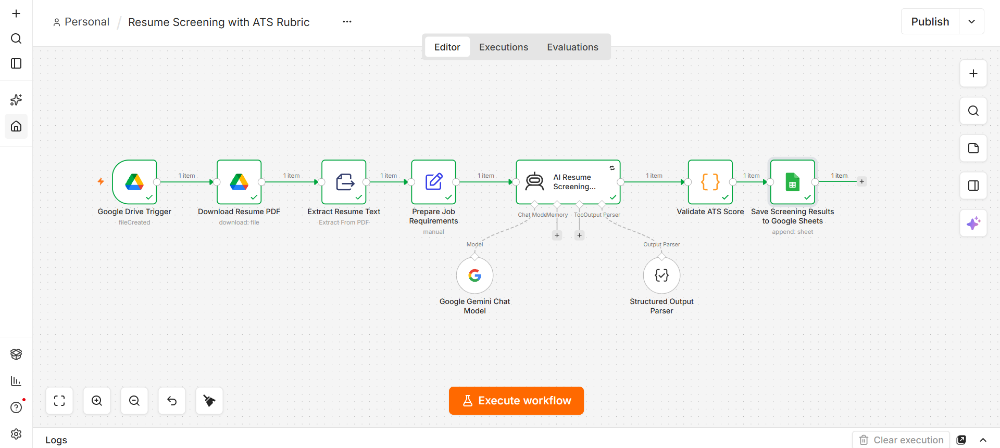
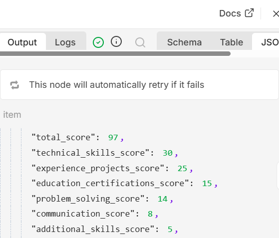
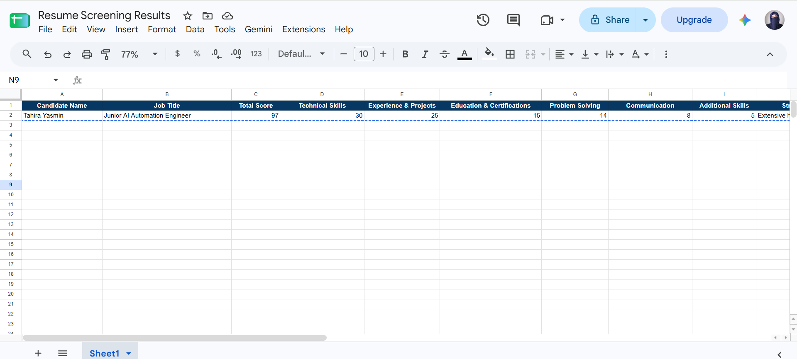
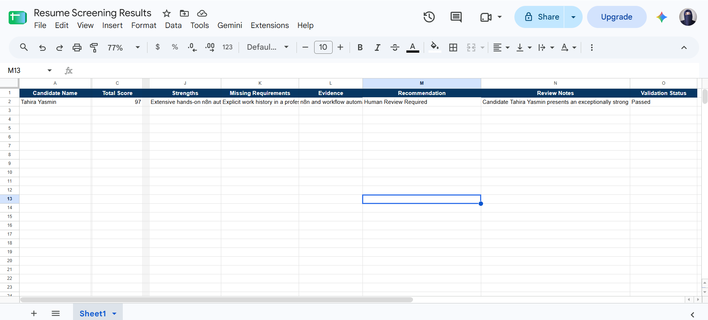

# AI Resume Screening with ATS Rubric

An AI-powered resume screening automation built with **n8n** that evaluates candidate resumes against predefined job requirements using a structured ATS scoring rubric.

## Project Overview

This project automates the initial resume evaluation process by extracting resume information, analyzing candidate qualifications, assigning scores across multiple categories, validating the scoring results, and storing the evaluation in Google Sheets.

The system is designed to support recruiters in reviewing applications more efficiently while keeping final hiring decisions under human control.

## Key Features

- **Automated Resume Processing:** Retrieves newly uploaded resumes from Google Drive.
- **Resume Text Extraction:** Extracts text from PDF resumes.
- **AI-Powered Evaluation:** Evaluates candidate qualifications against job requirements.
- **Structured ATS Scoring:** Assigns scores based on predefined evaluation categories.
- **Score Validation:** Checks category score limits and verifies the total score.
- **Human Review:** Keeps candidates subject to human review instead of making automatic rejection decisions.
- **Google Sheets Integration:** Stores candidate evaluation results for further review.

## ATS Evaluation Criteria

The system evaluates candidates using the following scoring rubric:

| Evaluation Category | Maximum Score |
|---|---:|
| Technical Skills | 30 |
| Experience & Projects | 25 |
| Education & Certifications | 15 |
| Problem Solving | 15 |
| Communication | 10 |
| Additional Skills | 5 |
| **Total** | **100** |

## Workflow Architecture

1. Google Drive Trigger detects a newly uploaded resume.
2. Download Resume PDF retrieves the resume.
3. Extract Resume Text extracts its content.
4. Prepare Job Requirements provides the job description and ATS rubric.
5. AI Resume Screening Agent evaluates the candidate.
6. Structured Output Parser formats the evaluation.
7. Validate ATS Score checks the scoring calculations.
8. Google Sheets stores the evaluation results.

## Evaluation Output

The workflow is designed to generate structured evaluation results, including:

- Candidate Name
- Job Title
- Total Score
- Technical Skills Score
- Experience & Projects Score
- Education & Certifications Score
- Problem Solving Score
- Communication Score
- Additional Skills Score
- Strengths
- Missing Requirements
- Supporting Evidence
- Recommendation
- Review Notes
- Validation Status

## Technology Stack

- n8n
- Google Gemini
- Google Drive
- Google Sheets
- JSON
- JavaScript

## Screenshots

### Workflow Overview

### ATS Evaluation

### Google Sheets Results

### Human Review

## Responsible AI & Human Oversight

The workflow is designed with responsible AI principles:

- Evaluations should be based on job-related evidence.
- The AI should not invent qualifications or experience.
- Protected personal characteristics should not influence scoring.
- Candidates should not be automatically rejected by the system.
- Final hiring decisions must remain with human reviewers.

## Setup Instructions

1. Import the workflow JSON into your n8n instance.
2. Configure your Google Drive credentials and resume folder.
3. Configure your Google Gemini credentials.
4. Connect your Google Sheets account.
5. Select your own spreadsheet and worksheet.
6. Review node configurations and test the workflow with sample resumes before activating it.

**Note:** The shared workflow JSON uses placeholder IDs and does not contain account-specific credentials. You must configure your own accounts and resources.

## Project Purpose

This project demonstrates how AI and workflow automation can assist with repetitive recruitment tasks, structured candidate evaluation, and organized resume management.

**Disclaimer:** This tool is intended to assist human reviewers. It should not be used as the sole basis for employment decisions.

## Author

**Tahira Yasmin**

BS Computer Science Student | AI Automation Enthusiast

[GitHub](https://github.com/TahiraYasmin)
